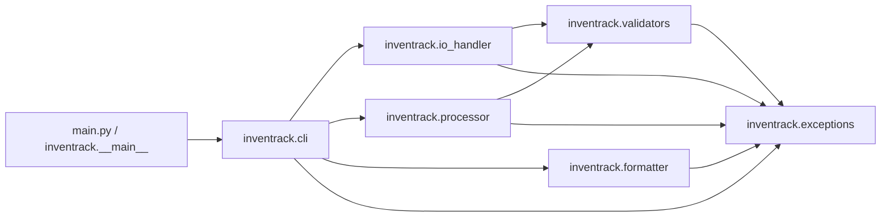

<div align="center">

# InvenTrack CLI

**Deterministic Warehouse Inventory Validation, Deduplication & Restock Analytics CLI**

[](https://www.python.org/)
[-2EA44F)](#stack--dependensi)
[](#pengujian)
[](#skema-data)
[](LICENSE)

**Bahasa Indonesia** | [简体中文](README.zh-CN.md) | [中文版源码 (`zh/`)](zh/README.md)

</div>

---

**InvenTrack CLI** adalah utilitas baris perintah (*command-line tool*) untuk memvalidasi, mendeduplikasi, mengklasifikasikan risiko stok, dan menghasilkan laporan valuasi inventaris multi-gudang dari berkas `.csv` maupun `.json`.

Dirancang tanpa dependensi eksternal (*zero third-party dependencies*), InvenTrack CLI dapat langsung dijalankan di lingkungan server, kontainer minimal, maupun *pipeline* otomasi hanya dengan instalasi standar Python `3.10+`.

## Fitur Utama

- **Defensive Schema Validation** — Menormalkan kode SKU, kategori, dan lokasi gudang; menolak nilai numerik negatif/pecahan stok/non-finite (`NaN`, `Inf`) serta tanggal di luar kalender ISO `YYYY-MM-DD`; mendukung isolasi baris rusak otomatis (default) maupun mode gagal-cepat (`--strict`).
- **Deterministic SKU Deduplication** — Menyaring rekaman SKU ganda lintas tanggal menggunakan strategi `latest` (berdasarkan `tanggal_update` terbaru) atau `first` (urutan kemunculan awal) lengkap dengan log audit perubahan.
- **Automated Stock Classification & Restock Sizing** — Mengkategorikan stok ke `HABIS`, `KRITIS`, `BERLEBIH`, atau `AMAN`, menghitung valuasi per SKU (`nilai_stok`), serta menyusun rekomendasi jumlah pengadaan ulang (`rekomendasi_restock`).
- **Fast Search, Multi-Criteria Filter & Group Rollups** — Pencarian SKU berindeks hash *O*(1) dengan *fallback* pencarian kata kunci lintas kolom, filter atribut & rentang harga, serta agregasi metrik per kategori, gudang, pemasok, atau status.
- **Dual Execution Mode** — Mendukung menu interaktif terminal untuk eksplorasi langsung serta subcommand CLI terstruktur untuk skrip dan ekspor berkas CSV/JSON.

---

## Quick Start

Membutuhkan **Python 3.10+** (`python3 --version`). Tidak memerlukan `pip install`.

```bash
# Clone dari GitHub
git clone https://github.com/Wxiszjw2/invertis.git
cd invertis

# Atau clone dari Gitee
git clone https://gitee.com/Wxiszjw/inventrack-cli.git
cd inventrack-cli
```

### Mode Interaktif

Menjalankan tanpa subcommand otomatis memuat dataset bawaan `data/input/inventaris_normal.csv` dan membuka sesi interaktif:

```bash
python3 main.py
# atau melalui eksekusi modul package:
python3 -m inventrack
```

> Untuk antarmuka dan kode sumber berbahasa Mandarin (简体中文), jalankan `python3 zh/main.py` (lihat [`zh/README.md`](zh/README.md)).

### Eksekusi Satu Baris (CLI)

```bash
python3 main.py analyze \
  --output-csv data/output/inventaris_bersih.csv \
  --output-json data/output/laporan_analisis.json
```

---

## Referensi CLI

Parameter `--input` bersifat opsional pada seluruh subcommand (default: `data/input/inventaris_normal.csv`).

| Subcommand | Deskripsi | Argumen & Flag |
| :--- | :--- | :--- |
| `analyze` | Menjalankan validasi, deduplikasi, klasifikasi stok, cetak ringkasan, dan ekspor opsional | `[--input PATH] [--output-csv PATH] [--output-json PATH] [--dedup-strategy {first,latest}] [--strict]` |
| `search` | Mencari item berdasarkan exact SKU atau substring lintas kolom | `[--input PATH] --query TEXT [--dedup-strategy {first,latest}]` |
| `filter` | Menyaring item berdasarkan kombinasi atribut & harga satuan | `[--input PATH] [--kategori TEXT] [--lokasi KODE] [--status {AMAN,BERLEBIH,HABIS,KRITIS}] [--min-harga N] [--max-harga N] [--output-csv PATH] [--dedup-strategy {first,latest}]` |
| `group` | Mengelompokkan item dan mencetak tabel agregasi per dimensi | `[--input PATH] [--by {kategori,lokasi_gudang,pemasok,status_stok}] [--dedup-strategy {first,latest}]` |
| `deduplicate` | Menghapus duplikat SKU dan menulis CSV ternormalisasi | `[--input PATH] --output-csv PATH [--strategy {first,latest}]` |
| `interactive` | Membuka menu interaktif dengan berkas awal opsional | `[--input PATH]` |

### Contoh Pemakaian

```bash
# Cari barang berdasarkan nama vendor atau kata kunci produk
python3 main.py search --query "PT Teknologi"

# Saring SKU berstatus KRITIS dan simpan ke CSV
python3 main.py filter --status KRITIS --output-csv data/output/hasil_filter_kritis.csv

# Tampilkan rekapitulasi unit dan valuasi per lokasi gudang
python3 main.py group --by lokasi_gudang

# Bersihkan SKU ganda menggunakan rekaman paling mutakhir
python3 main.py deduplicate --output-csv data/output/inventaris_bersih.csv --strategy latest

# Validasi ketat (keluar dengan kode 1 bila ditemukan satu saja baris rusak)
python3 main.py analyze --input data/input/inventaris_edge_dirty.csv --strict
```

<details>
<summary>Contoh Output Terminal (<code>analyze</code>)</summary>

Hasil eksekusi pada `data/input/inventaris_normal.csv` (**28 baris mentah** -> **25 SKU unik**, `1.004` total unit, valuasi `Rp141.607.000`, rata-rata harga `Rp541.880`, distribusi `HABIS: 3 | KRITIS: 6 | AMAN: 12 | BERLEBIH: 4`):

```text
[Daftar Barang Perlu Restock (9 SKU)]
  - [HABIS ] SKU-001 | Scanner Barcode Wireless 2D (GUDANG-A) -> Stok: 0/5, Saran Restock: +10 unit
  - [HABIS ] SKU-008 | Bor Tangan Cordless 18V (GUDANG-B) -> Stok: 0/4, Saran Restock: +8 unit
  - [HABIS ] SKU-016 | Helm Proyek Standar SNI (GUDANG-C) -> Stok: 0/10, Saran Restock: +20 unit
  - [KRITIS] SKU-017 | Sepatu Safety Steel Toe (GUDANG-A) -> Stok: 2/8, Saran Restock: +14 unit
  - [KRITIS] SKU-002 | Printer Label Thermal 80mm (GUDANG-A) -> Stok: 3/5, Saran Restock: +7 unit
  - [KRITIS] SKU-003 | Router Industri Dual-Band (GUDANG-A) -> Stok: 4/6, Saran Restock: +8 unit
  - [KRITIS] SKU-009 | Kunci Momen Digital 1/2 Inch (GUDANG-B) -> Stok: 5/5, Saran Restock: +5 unit
  - [KRITIS] SKU-012 | Kertas Label Termal 100x150mm (GUDANG-C) -> Stok: 6/10, Saran Restock: +14 unit
  - [KRITIS] SKU-022 | Kardus Packing Double Wall 40x40 (GUDANG-C) -> Stok: 10/15, Saran Restock: +20 unit

Duplikat SKU ditangani (3):
  - [SKU-003] Digantikan oleh record lebih baru (2026-11-05 > 2026-10-10).
  - [SKU-011] Dipertahankan record awal (2026-11-12) berdasarkan strategi 'latest'.
  - [SKU-019] Digantikan oleh record lebih baru (2026-11-18 > 2026-10-15).
```

</details>

---

## Skema Data

### Format Input (`.csv` / `.json`)

Parser menerima berkas CSV ber-header (UTF-8 / UTF-8 BOM) maupun berkas JSON berbentuk array objek `[...]` atau objek `{"items": [...]}` dengan **9 field wajib**:

| Field | Tipe | Aturan Validasi & Normalisasi |
| :--- | :--- | :--- |
| `sku` | `str` | Non-kosong; spasi dirapikan dan diubah ke huruf kapital (`SKU-001`) |
| `nama_barang` | `str` | Non-kosong; spasi ganda dinormalisasi |
| `kategori` | `str` | Non-kosong; dinormalisasi ke *Title Case* |
| `lokasi_gudang` | `str` | Non-kosong; dinormalisasi ke huruf kapital (`GUDANG-A`) |
| `stok` | `int` | Bilangan bulat `>= 0` (menolak boolean, negatif, dan angka desimal) |
| `stok_minimum` | `int` | Bilangan bulat `>= 0` |
| `harga_satuan` | `float` | Angka *finite* `>= 0.0`, dibulatkan ke 2 desimal |
| `pemasok` | `str` | Non-kosong; spasi ganda dinormalisasi |
| `tanggal_update` | `str` | Tanggal kalender valid berformat ketat `YYYY-MM-DD` |

### Kolom Turunan & Aturan Klasifikasi

Saat diproses oleh [`inventrack/processor.py`](inventrack/processor.py), setiap record unik diperkaya secara imutabel menjadi **12 kolom ekspor CSV** dengan tiga field kalkulasi:

- `nilai_stok`: `round(stok * harga_satuan, 2)`
- `status_stok` & `rekomendasi_restock` (dievaluasi berurutan):

| Urutan | `status_stok` | Kondisi | `rekomendasi_restock` |
| :---: | :--- | :--- | :--- |
| `1` | `HABIS` | `stok == 0` | `max(0, (stok_minimum * 2) - stok)` |
| `2` | `KRITIS` | `stok <= stok_minimum` | `max(0, (stok_minimum * 2) - stok)` |
| `3` | `BERLEBIH` | `stok_minimum > 0 and stok > stok_minimum * 5` | `0` |
| `4` | `AMAN` | Kondisi lainnya | `0` |

---

## Arsitektur & Struktur Proyek

```text
inventrack-cli/
├── pyproject.toml                     # Metadata proyek PEP 621 & entry point skrip
├── LICENSE                            # Lisensi MIT
├── main.py                            # Entry point CLI utama
├── inventrack/                        # Package inti (Bahasa Indonesia)
│   ├── __init__.py                    # Ekspor API publik (__version__ = "1.1.0")
│   ├── __main__.py                    # Runner modul `python3 -m inventrack`
│   ├── exceptions.py                  # Hierarki custom exception domain
│   ├── validators.py                  # Skema TypedDict & normalisasi tipe data
│   ├── io_handler.py                  # Pembaca CSV/JSON & penulis atomik (os.replace)
│   ├── processor.py                   # Deduplikasi, klasifikasi, pencarian, filter & agregasi
│   ├── formatter.py                   # Formatter IDR & tabel ASCII lebar Unicode
│   └── cli.py                         # Parser subcommand argparse (`-V/--version`) & mode interaktif
├── data/
│   ├── input/                         # Dataset sampel & skenario batas (CSV/JSON)
│   └── output/                        # Contoh hasil ekspor CSV bersih & laporan JSON
├── tests/
│   └── test_inventrack.py             # Suite pengujian unit, integrasi & regresi (30 test)
└── zh/                                # Implementasi mandiri berbahasa Mandarin (简体中文)
    ├── main.py
    ├── inventrack_zh/                 # Package lengkap dengan perataan tabel karakter CJK
    ├── data/
    └── tests/                         # Suite pengujian versi Mandarin (30 test)
```

### Grafik Dependensi Modul

Arsitektur memisahkan lapisan antarmuka CLI, I/O berkas, pemrosesan murni, pemformatan tampilan, dan validasi dalam grafik dependensi satu arah (asiklik):



| Modul | Tanggung Jawab Inti | Antarmuka Publik Utama |
| :--- | :--- | :--- |
| [`exceptions.py`](inventrack/exceptions.py) | Kontrak error domain terstruktur | `InvenTrackError`, `DataFileNotFoundError`, `UnsupportedFormatError`, `InvalidDataFormatError`, `RecordValidationError`, `InvalidUserInputError` |
| [`validators.py`](inventrack/validators.py) | Sanitasi dan validasi level field/record | `normalize_sku`, `normalize_text`, `parse_non_negative_int`, `parse_non_negative_float`, `validate_iso_date`, `validate_and_normalize_record` |
| [`io_handler.py`](inventrack/io_handler.py) | Operasi baca/tulis CSV & JSON secara defensif | `validate_input_path`, `detect_file_format`, `load_raw_csv`, `load_raw_json`, `load_inventory`, `save_inventory_csv`, `save_report_json` |
| [`processor.py`](inventrack/processor.py) | Transformasi imutabel, indeks & analitik stok | `classify_stock_status`, `calculate_restock_recommendation`, `enrich_records`, `deduplicate_records`, `build_sku_index`, `search_records`, `filter_records`, `group_records`, `extract_unique_metadata`, `calculate_group_recap`, `calculate_summary` |
| [`formatter.py`](inventrack/formatter.py) | Serialisasi tampilan teks & tabel terminal | `format_currency_idr`, `format_records_table`, `format_group_recap_table`, `format_rejected_rows`, `format_duplicates_log`, `format_summary_text` |
| [`cli.py`](inventrack/cli.py) | Routing subcommand, prompt interaktif & kode keluar | `build_parser`, `run_interactive_session`, `prompt_optional_float`, `main` |

---

## Dataset Sampel & Penanganan Edge Case

Direktori [`data/input/`](data/input) dan [`data/output/`](data/output) menyertakan dataset siap pakai untuk memverifikasi alur normal maupun kondisi batas:

| Berkas Input | Karakteristik | Perilaku Terverifikasi | Contoh Output |
| :--- | :--- | :--- | :--- |
| `inventaris_normal.csv` | 28 baris, memuat 3 SKU duplikat lintas tanggal | Menghasilkan `25` SKU unik, `1.004` unit, total `Rp141.607.000`, `3` log duplikat | [`laporan_analisis.json`](data/output/laporan_analisis.json), [`inventaris_bersih.csv`](data/output/inventaris_bersih.csv), [`hasil_filter_kritis.csv`](data/output/hasil_filter_kritis.csv) |
| `inventaris_edge_empty.csv` | Hanya baris header (`0` record) | Menghasilkan metrik `0` dan nilai ekstrem `null` tanpa *ZeroDivisionError* | [`laporan_edge_empty.json`](data/output/laporan_edge_empty.json) |
| `inventaris_edge_dirty.csv` | Prefix UTF-8 BOM (`\ufeff`) + 5 baris cacat | Memproses `3` SKU valid (`Rp1.900.000`) & mengisolasi `5` baris rusak ke `log_baris_ditolak` | [`laporan_edge_dirty.json`](data/output/laporan_edge_dirty.json) |
| `inventaris_edge_unicode.json` | Dokumen JSON UTF-8 simbol/aksen + duplikat beda case | Menormalkan `" sku-j01 "` -> `"SKU-J01"`, menghasilkan `3` SKU unik (`Rp105.100.049`) | [`laporan_edge_unicode.json`](data/output/laporan_edge_unicode.json) |

### Kode Keluar (*Exit Codes*)

| Kode | Kondisi | Keterangan |
| :---: | :--- | :--- |
| `0` | Sukses | Subcommand selesai atau pengguna keluar normal dari mode interaktif |
| `1` | Domain / Input Error | Turunan `InvenTrackError` tercetak rapi ke `stderr` tanpa *raw traceback* |
| `2` | CLI Usage Error | Argumen/flag tidak dikenali oleh `argparse` |
| `130` | Interrupted | Proses dihentikan pengguna melalui `SIGINT` (`Ctrl+C`) |

---

## Pengujian

Suite pengujian mencakup **60 test cases** (`30` pada [`tests/test_inventrack.py`](tests/test_inventrack.py) dan `30` pada [`zh/tests/test_inventrack_zh.py`](zh/tests/test_inventrack_zh.py)) meliputi unit test validator, pelacakan kolom error (`field_name`), logika deduplikasi tanggal tidak berurutan, penulisan berkas atomik bebas korup, pembacaan BOM CSV/JSON, subcommand CLI *end-to-end*, dan simulasi input interaktif:

```bash
# Jalankan test suite utama
python3 -m unittest discover -s tests -v

# Jalankan test suite versi Mandarin (zh/)
python3 -m unittest discover -s zh/tests -v
```

---

## Stack & Dependensi

- **Runtime**: Python `3.10+`
- **External Dependencies**: `0` (tidak membutuhkan paket PyPI eksternal)
- **Standard Library Modules**: `argparse`, `csv`, `json`, `os`, `tempfile`, `pathlib`, `datetime`, `math`, `sys`, `collections.abc`, `typing`, `unicodedata`, `unittest`

---

## Author & Lisensi

Dirancang dan dikembangkan oleh **Robani Ichsan** ([GitHub @Wxiszjw2](https://github.com/Wxiszjw2) · [Gitee @Wxiszjw](https://gitee.com/Wxiszjw)).  
Dirilis di bawah lisensi [MIT License](LICENSE).
