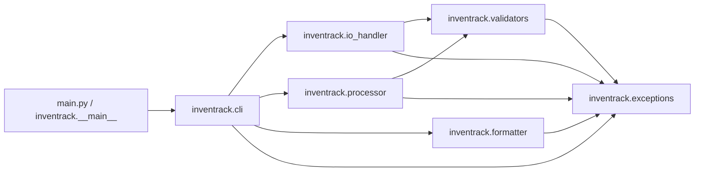

<div align="center">

# InvenTrack CLI

**确定性多仓库库存数据校验、去重与补货分析命令行工具**

[](https://www.python.org/)
[-2EA44F)](#技术栈与依赖)
[](#测试套件)
[](#数据规范)
[](LICENSE)

[Bahasa Indonesia](README.md) | **简体中文** | [简体中文版源码 (`zh/`)](zh/README.md)

</div>

---

**InvenTrack CLI** 是一款轻量级命令行库存数据处理工具，用于对 `.csv` 与 `.json` 格式的多仓库库存台账执行模式校验、跨日期 SKU 去重、库存风险分级、估值聚合及补货量测算。

全项目基于 **Python 标准库** 构建（零第三方依赖），无需配置虚拟环境或安装额外包，即可直接部署于服务器、极简容器或定时批处理流水线中（要求 Python `3.10+`）。

## 核心特性

- **防御式数据校验** — 自动清理多余空白并统一 SKU/仓库编码格式；严格拦截负数、小数库存、`NaN`/`Inf` 非有限数值及非法公历日期（如 `2026-02-30`）；支持默认容错隔离模式与 `--strict` 快速失败模式。
- **确定性 SKU 去重** — 支持 `latest`（按最新 `tanggal_update` 保留，兼容乱序历史记录）与 `first`（保留首次出现记录）两种策略，并输出完整去重审计日志。
- **库存状态分级与补货测算** — 自动划分 `HABIS`（缺货）、`KRITIS`（预警）、`BERLEBIH`（积压）、`AMAN`（正常）四级状态，计算库存估值 `nilai_stok` 与目标安全缓冲补货量 `rekomendasi_restock`。
- **O(1) 检索、组合筛选与多维聚合** — 基于哈希索引的 SKU 精确查找与跨字段子串检索、多条件组合过滤（类别、仓库、状态、单价区间），以及按维度输出汇总统计表。
- **双运行模式** — 同时提供开箱即用的终端交互式菜单与适合脚本编排的 CLI 子命令。

---

## 快速开始

确保环境已安装 **Python 3.10+**（`python3 --version`），无需执行 `pip install`。

```bash
# 从 GitHub 克隆
git clone https://github.com/Wxiszjw2/invertis.git
cd invertis

# 或从 Gitee 克隆
git clone https://gitee.com/Wxiszjw/inventrack-cli.git
cd inventrack-cli
```

### 交互式运行

不带子命令直接启动时，程序会自动加载默认数据集 `data/input/inventaris_normal.csv` 并进入交互菜单：

```bash
# 启动主版本（印度尼西亚语界面）
python3 main.py
# 或作为包模块运行：
python3 -m inventrack

# 启动全中文化独立版本（中文界面、中文等宽表格与中文数据集）
python3 zh/main.py
```

> 有关 `zh/` 目录中独立中文源码包的详细说明，请参阅 [`zh/README.md`](zh/README.md)。

### 命令行一键分析与导出

```bash
python3 main.py analyze \
  --output-csv data/output/inventaris_bersih.csv \
  --output-json data/output/laporan_analisis.json
```

---

## CLI 命令参考

所有子命令的 `--input` 参数均为可选（默认读取 `data/input/inventaris_normal.csv`）。

| 子命令 | 功能说明 | 参数与选项 |
| :--- | :--- | :--- |
| `analyze` | 执行校验、去重、风险分级、终端摘要打印及可选 CSV/JSON 导出 | `[--input PATH] [--output-csv PATH] [--output-json PATH] [--dedup-strategy {first,latest}] [--strict]` |
| `search` | 按精确 SKU 或跨字段关键词检索库存项 | `[--input PATH] --query TEXT [--dedup-strategy {first,latest}]` |
| `filter` | 按类别、仓库、状态与单价区间组合筛选记录 | `[--input PATH] [--kategori TEXT] [--lokasi CODE] [--status {AMAN,BERLEBIH,HABIS,KRITIS}] [--min-harga N] [--max-harga N] [--output-csv PATH] [--dedup-strategy {first,latest}]` |
| `group` | 按指定维度聚合并打印分组统计表 | `[--input PATH] [--by {kategori,lokasi_gudang,pemasok,status_stok}] [--dedup-strategy {first,latest}]` |
| `deduplicate` | 执行 SKU 去重并输出规范化 CSV 文件 | `[--input PATH] --output-csv PATH [--strategy {first,latest}]` |
| `interactive` | 启动终端交互式菜单会话 | `[--input PATH]` |

### 常用示例

```bash
# 按供应商名称或商品关键词搜索
python3 main.py search --query "PT Teknologi"

# 筛选处于 KRITIS 预警状态的 SKU 并导出 CSV
python3 main.py filter --status KRITIS --output-csv data/output/hasil_filter_kritis.csv

# 按仓库位置分组统计件数与估值
python3 main.py group --by lokasi_gudang

# 按最新更新日期去重并写出干净 CSV
python3 main.py deduplicate --output-csv data/output/inventaris_bersih.csv --strategy latest

# 对含异常记录的数据启用严格模式（发现无效行立即返回退出码 1）
python3 main.py analyze --input data/input/inventaris_edge_dirty.csv --strict
```

<details>
<summary>终端输出示例 (<code>analyze</code>)</summary>

在默认数据集 `data/input/inventaris_normal.csv` 上的运行结果（**28 条原始行** -> **25 个唯一 SKU**，总计 `1,004` 件，总估值 `Rp141.607.000`，均价 `Rp541.880`，状态分布 `HABIS: 3 | KRITIS: 6 | AMAN: 12 | BERLEBIH: 4`）：

```text
[Daftar Barang Perlu Restock (9 SKU)]
  - [HABIS ] SKU-001 | Scanner Barcode Wireless 2D (GUDANG-A) -> Stok: 0/5, Saran Restock: +10 unit
  - [HABIS ] SKU-008 | Bor Tangan Cordless 18V (GUDANG-B) -> Stok: 0/4, Saran Restock: +8 unit
  - [HABIS ] SKU-016 | Helm Proyek Standar SNI (GUDANG-C) -> Stok: 0/10, Saran Restock: +20 unit
  - [KRITIS] SKU-017 | Sepatu Safety Steel Toe (GUDANG-A) -> Stok: 2/8, Saran Restock: +14 unit
  - [KRITIS] SKU-002 | Printer Label Thermal 80mm (GUDANG-A) -> Stok: 3/5, Saran Restock: +7 unit
  - [KRITIS] SKU-003 | Router Industri Dual-Band (GUDANG-A) -> Stok: 4/6, Saran Restock: +8 unit
  - [KRITIS] SKU-009 | Kunci Momen Digital 1/2 Inch (GUDANG-B) -> Stok: 5/5, Saran Restock: +5 unit
  - [KRITIS] SKU-012 | Kertas Label Termal 100x150mm (GUDANG-C) -> Stok: 6/10, Saran Restock: +14 unit
  - [KRITIS] SKU-022 | Kardus Packing Double Wall 40x40 (GUDANG-C) -> Stok: 10/15, Saran Restock: +20 unit

Duplikat SKU ditangani (3):
  - [SKU-003] Digantikan oleh record lebih baru (2026-11-05 > 2026-10-10).
  - [SKU-011] Dipertahankan record awal (2026-11-12) berdasarkan strategi 'latest'.
  - [SKU-019] Digantikan oleh record lebih baru (2026-11-18 > 2026-10-15).
```

</details>

---

## 数据规范

### 输入结构（`.csv` / `.json`）

支持带表头的 CSV 文件（兼容 UTF-8 与 UTF-8 BOM）以及 JSON 文件（根节点为数组 `[...]` 或 `{"items": [...]}`），每条记录须包含以下 **9 个必填字段**：

| 字段名 | 类型 | 校验与规范化规则 |
| :--- | :--- | :--- |
| `sku` | `str` | 非空；压缩多余空白并统一转为大写（如 `SKU-001`） |
| `nama_barang` | `str` | 非空；清理首尾与连续空白 |
| `kategori` | `str` | 非空；规范化为首字母大写格式 |
| `lokasi_gudang` | `str` | 非空；统一转为大写仓库编码（如 `GUDANG-A`） |
| `stok` | `int` | 整数且 `>= 0`（拒绝布尔值、负数与小数） |
| `stok_minimum` | `int` | 整数且 `>= 0` |
| `harga_satuan` | `float` | 有限浮点数且 `>= 0.0`，四舍五入保留 2 位小数 |
| `pemasok` | `str` | 非空；清理多余空白 |
| `tanggal_update` | `str` | 合法的公历 `YYYY-MM-DD` 日期字符串 |

### 衍生字段与分级规则

[`inventrack/processor.py`](inventrack/processor.py) 以不可变方式为每条唯一记录生成 3 个衍生字段（导出 CSV 共 **12 列**）：

- `nilai_stok`：`round(stok * harga_satuan, 2)`
- `status_stok` 与 `rekomendasi_restock`（按序匹配）：

| 优先级 | `status_stok` | 判定条件 | `rekomendasi_restock` |
| :---: | :--- | :--- | :--- |
| `1` | `HABIS` | `stok == 0` | `max(0, (stok_minimum * 2) - stok)` |
| `2` | `KRITIS` | `stok <= stok_minimum` | `max(0, (stok_minimum * 2) - stok)` |
| `3` | `BERLEBIH` | `stok_minimum > 0 and stok > stok_minimum * 5` | `0` |
| `4` | `AMAN` | 其余区间 | `0` |

---

## 项目架构

```text
inventrack-cli/
├── pyproject.toml                     # PEP 621 项目元数据与命令行脚本配置
├── LICENSE                            # MIT 开源许可证
├── main.py                            # CLI 主入口
├── inventrack/                        # 核心处理包
│   ├── __init__.py                    # 包公开导出接口 (__version__ = "1.1.0")
│   ├── __main__.py                    # 支持 `python3 -m inventrack`
│   ├── exceptions.py                  # 领域异常层级定义
│   ├── validators.py                  # TypedDict 类型契约与字段校验转换
│   ├── io_handler.py                  # CSV/JSON 读取与原子化安全写入 (os.replace)
│   ├── processor.py                   # 去重、分级、检索、筛选与分组聚合
│   ├── formatter.py                   # IDR 金额与 Unicode 宽字符对齐表格渲染
│   └── cli.py                         # Argparse 子命令路由 (`-V/--version`) 与交互会话
├── data/
│   ├── input/                         # 示例数据集与边界测试数据 (CSV/JSON)
│   └── output/                        # 导出的规范化 CSV 与 JSON 分析报告示例
├── tests/
│   └── test_inventrack.py             # 主版本单元、集成与回归测试套件 (30 项)
└── zh/                                # 简体中文独立源码实现
    ├── main.py
    ├── inventrack_zh/                 # 全中文包（含 CJK 东亚宽字符表格对齐支持）
    ├── data/
    └── tests/                         # 中文版测试套件 (30 项)
```

### 模块依赖拓扑

各模块职责单一，保持单向无环调用关系，将 CLI 控制层、文件 I/O、纯函数业务计算与终端格式化解耦：



| 模块 | 核心职责 | 主要公开符号 |
| :--- | :--- | :--- |
| [`exceptions.py`](inventrack/exceptions.py) | 结构化领域异常定义 | `InvenTrackError`、`DataFileNotFoundError`、`UnsupportedFormatError`、`InvalidDataFormatError`、`RecordValidationError`、`InvalidUserInputError` |
| [`validators.py`](inventrack/validators.py) | 字段清洗与记录级校验 | `normalize_sku`、`normalize_text`、`parse_non_negative_int`、`parse_non_negative_float`、`validate_iso_date`、`validate_and_normalize_record` |
| [`io_handler.py`](inventrack/io_handler.py) | 防御式 CSV/JSON 解析与导出 | `validate_input_path`、`detect_file_format`、`load_raw_csv`、`load_raw_json`、`load_inventory`、`save_inventory_csv`、`save_report_json` |
| [`processor.py`](inventrack/processor.py) | 不可变记录增强、哈希索引与汇总分析 | `classify_stock_status`、`calculate_restock_recommendation`、`enrich_records`、`deduplicate_records`、`build_sku_index`、`search_records`、`filter_records`、`group_records`、`extract_unique_metadata`、`calculate_group_recap`、`calculate_summary` |
| [`formatter.py`](inventrack/formatter.py) | 货币、表格与多段终端文本格式化 | `format_currency_idr`、`format_records_table`、`format_group_recap_table`、`format_rejected_rows`、`format_duplicates_log`、`format_summary_text` |
| [`cli.py`](inventrack/cli.py) | 参数解析、交互提示与退出码控制 | `build_parser`、`run_interactive_session`、`prompt_optional_float`、`main` |

---

## 示例数据与边界覆盖

[`data/input/`](data/input) 与 [`data/output/`](data/output) 包含四组可直接复现的数据集：

| 输入文件 | 数据特征 | 验证行为 | 对应产出示例 |
| :--- | :--- | :--- | :--- |
| `inventaris_normal.csv` | 28 行记录，含 3 组跨日期重复 SKU | 输出 `25` 个唯一 SKU、`1,004` 件、总估值 `Rp141.607.000` 及 `3` 条去重审计记录 | [`laporan_analisis.json`](data/output/laporan_analisis.json)、[`inventaris_bersih.csv`](data/output/inventaris_bersih.csv)、[`hasil_filter_kritis.csv`](data/output/hasil_filter_kritis.csv) |
| `inventaris_edge_empty.csv` | 仅含表头（`0` 条数据） | 安全输出零值统计与 `null` 极值项，避免除零或空序列异常 | [`laporan_edge_empty.json`](data/output/laporan_edge_empty.json) |
| `inventaris_edge_dirty.csv` | UTF-8 BOM 头（`\ufeff`）+ 5 条异常数据 | 正常处理 `3` 条有效记录（`Rp1.900.000`），将 `5` 条错误记录隔离至 `log_baris_ditolak` | [`laporan_edge_dirty.json`](data/output/laporan_edge_dirty.json) |
| `inventaris_edge_unicode.json` | 多语言符号 JSON + 大小写/空格差异重复项 | 将 `" sku-j01 "` 归一为 `"SKU-J01"` 并按最新日期合并，输出 `3` 个唯一 SKU（`Rp105.100.049`） | [`laporan_edge_unicode.json`](data/output/laporan_edge_unicode.json) |

### 进程退出码 (*Exit Codes*)

| 退出码 | 状态说明 | 行为表现 |
| :---: | :--- | :--- |
| `0` | 正常完成 | 子命令执行完毕或从交互菜单正常退出 |
| `1` | 业务或数据错误 | 捕获 `InvenTrackError` 并向 `stderr` 打印可读诊断信息，不暴露原始堆栈 |
| `2` | 命令行参数错误 | `argparse` 检测到未定义选项或缺少必填参数 |
| `130` | 用户中断 | 捕获 `SIGINT`（`Ctrl+C`）并安全退出 |

---

## 测试套件

项目内置 **60 个自动化测试用例**（[`tests/test_inventrack.py`](tests/test_inventrack.py) 30 项 + [`zh/tests/test_inventrack_zh.py`](zh/tests/test_inventrack_zh.py) 30 项），覆盖字段校验器、错误列名定位（`field_name`）、乱序日期去重、原子写入异常回滚、UTF-8 BOM 与 JSON 解析、CLI 子命令端到端运行以及交互式输入容错：

```bash
# 运行主版本测试套件
python3 -m unittest discover -s tests -v

# 运行中文版测试套件 (zh/)
python3 -m unittest discover -s zh/tests -v
```

---

## 技术栈与依赖

- **运行环境**：Python `3.10+`
- **第三方依赖**：`0`（无需安装任何外部 PyPI 包）
- **使用的标准库模块**：`argparse`、`csv`、`json`、`os`、`tempfile`、`pathlib`、`datetime`、`math`、`sys`、`collections.abc`、`typing`、`unicodedata`、`unittest`

---

## 作者与许可证

由 **Robani Ichsan**（[GitHub @Wxiszjw2](https://github.com/Wxiszjw2) · [Gitee @Wxiszjw](https://gitee.com/Wxiszjw)）设计与维护，基于 [MIT License](LICENSE) 开源发布。
